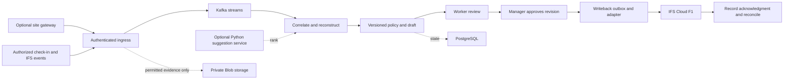

# Architecture

## Pilot and fleet

The 30-day pilot uses one Azure-hosted Go application, PostgreSQL, a test IFS feed and the React workflow. The database holds the outbox and idempotency records. Deploy a camera gateway only after the customer signs off on a separate activation decision. Shadow mode generates drafts and compares them against approved records.

The fleet design integrates with the stated Kairos/Nexus architecture. Confirm actual gateway, tenancy and event services with the platform owners. Go services own ingestion, reconstruction, policy, draft lifecycle and writeback. Kafka decouples ingest from processing. Python handles optional edge detection and, where validated, cloud inference and evaluation. Azure Blob stores only approved evidence objects. PostgreSQL owns application state by component. Deploy on AKS when operating requirements justify it and reuse existing regional infrastructure.

## Time reconstruction

1. Normalize times to UTC. Retain source offset, site IANA zone, clock-health estimate and ingestion time. Use tenant policy to group overnight shifts and allocate totals across midnight and DST. Ambiguous local times require a source offset or explicit correction.
2. Dedupe before applying a deterministic event-time order with a version/sequence tie-breaker. Reject same-key conflicts or unresolved simultaneous transitions. Use a late-event watermark and bounded replay. Keep the input event IDs and policy version on each interval.
3. Open an interval from a positive transition and close it only on supporting evidence or worker attestation. Compare against schedules, leave and existing entries. Work status or validated human evidence establishes completion. An estimated duration or site presence can support a suggestion about allocation.
4. Flag missing ends, overlaps, missing breaks, assignment conflicts and policy thresholds. Keep candidate work orders separate. A worker may hold multiple assignments, but totals cannot double-count payable minutes. No invented hours, breaks, mileage, completion or overtime.
5. Generate a new draft revision on late arrivals while unapproved. A governed correction supersedes an approved revision. Offline edits sync with the base revision and a stable command ID, and conflicts need explicit review.

## ML evaluation

Compare rules, logistic regression, and random forest or gradient boosting. Candidate features include assigned order, schedule overlap, task type, event sequence, planned duration and historical approved allocations available at draft time. Use authorized attendance only where permitted. Avoid unnecessary sensitive inputs. Evaluate on future shifts and held-out tenant/site cohorts to reduce leakage and measure transfer. Compare activity precision/recall, project match, calibration (Brier score and reliability curves), coverage/abstention and harm from incorrect suggestions.

An LLM would be considered only for extraction from ambiguous permitted text. Require schema checks, attributed source spans, redaction and abstention. No model authorizes payment. Keep feature/model versions, monitor drift and route low-confidence or novel cases to deterministic rules and human review. Camera confidence concerns observation quality and never proves employee identity.

## IFS boundary

F1 owns the Oracle/PLSQL business boundary and authoritative approved time, expense, payroll and finance records. Read through documented events and mappings, and use a supported, permissioned OData projection for writes. Discover the deployed release’s contracts and verify legal-entity mapping, service identity, retry semantics and acknowledgment. No production endpoint is assumed. [IFS API Explorer](https://docs.ifs.com/techdocs/26r1/040_tailoring/300_extensibility/010_get_started/), [IFS API policy](https://docs.ifs.com/policy/APIUsageCloud.pdf).

Commit an approved revision and a stable tenant/revision outbox record atomically. Lease the record, validate again, send through the adapter, and mark posted only on a durable authoritative acknowledgment. After an ambiguous outcome, reconcile by external reference before retrying. If the supported contract cannot provide safe lookup, route the item to a human. Apply bounded backoff on transient failures, quarantine permanent failures, and alert on reconciliation age.

## Signals and failure states

Trace with OpenTelemetry and collect rate, lag, age and outcome metrics in Prometheus/Grafana or Azure Monitor. Separate edge spool age, event staleness, draft generation time and ERP acknowledgment time. Keep identifiers out of metrics labels. Exercise camera loss, database restore, duplicate event delivery, clock drift, schema changes and response loss.
